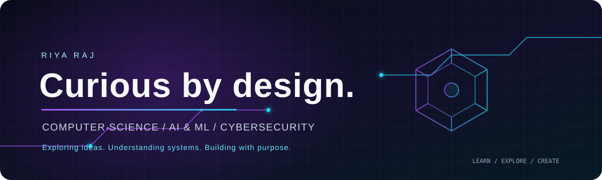

<div align="center">
  
</div>

<h1 align="center">Riya Raj</h1>

<p align="center">
  <b>BCA (Honours) Student · Computer Science Enthusiast · AI/ML & Cybersecurity Explorer</b>
</p>

<p align="center">
  <a href="https://github.com/RiyaRaj26">GitHub</a>
  &nbsp;·&nbsp; Parul University, Vadodara
  &nbsp;·&nbsp; Third Year
</p>

---

## `01 / ABOUT`

I'm a third-year **Bachelor of Computer Applications (Honours)** student at **Parul University**, interested in understanding how technology works and how it can be used to solve problems.

My interests span **Artificial Intelligence, Machine Learning, Cybersecurity, and Software Development**. I enjoy exploring different areas of computer science, experimenting with tools, and building a stronger technical foundation through coursework and hands-on learning.

```text
FOCUS   →  Computer Science | AI & Machine Learning | Cybersecurity
MINDSET →  Stay curious. Learn continuously. Keep experimenting.
```

## `02 / TECHNOLOGY TOOLKIT`

### Programming Languages

<p>
  
  
  
  
  
  
</p>

### Web & Application Development

<p>
  
  
  
  
</p>

### AI, Machine Learning & Data

<p>
  
  
  
  
  
  
</p>

### Databases & Backend

<p>
  
  
  
  
</p>

### Cybersecurity & Networking

<p>
  
  
  
</p>

- Network scanning and traffic analysis
- Network security fundamentals
- Password security and hashing
- Security testing fundamentals

### Developer Tools

<p>
  
  
  
  
</p>

## `03 / COMPUTER SCIENCE FOUNDATION`

- Data Structures & Algorithms
- Object-Oriented Programming
- Database Management Systems
- Operating Systems
- Computer Networks
- Software Engineering
- System Analysis & Design
- Information Security

## `04 / AREAS OF INTEREST`

| Domain | What I enjoy exploring |
|:--|:--|
| **Artificial Intelligence** | Intelligent systems and practical AI applications |
| **Machine Learning** | Learning algorithms, model development and neural networks |
| **Cybersecurity** | Network security, system analysis and digital protection |
| **Software Development** | Programming, application development and problem-solving |

## `05 / CURRENTLY EXPLORING`

- Strengthening programming and problem-solving skills
- Deepening my understanding of AI, Machine Learning and Deep Learning
- Exploring cybersecurity tools and network analysis
- Improving web development and backend development knowledge
- Learning modern software development practices

---

<div align="center">

**CONNECT**

[](https://github.com/RiyaRaj26)

<sub>Curiosity is the starting point. Learning is the process.</sub>

</div>
